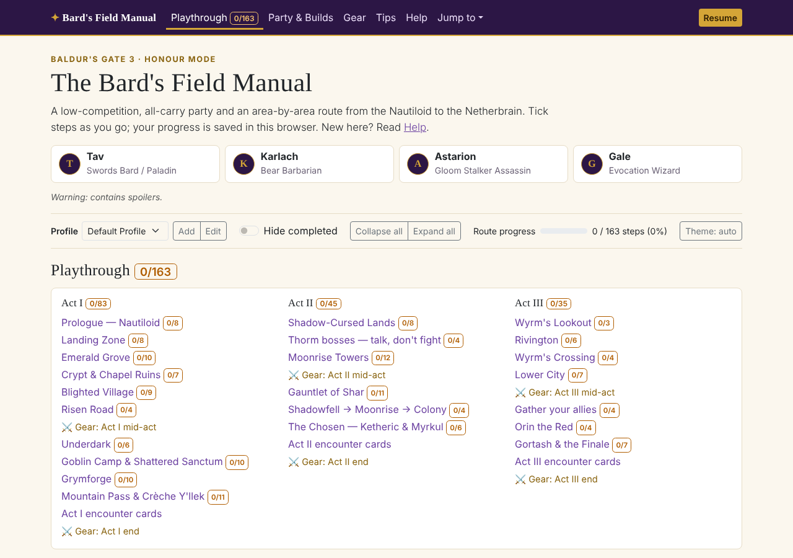

# Baldur's Gate 3: Honour Mode Cheat Sheet — The Bard's Field Manual

An interactive checklist for a Baldur's Gate 3 Honour Mode run with a Swords Bard / Paladin-led party (Tav, Karlach, Astarion, Gale). It walks area by area from the Nautiloid to the Netherbrain, with encounter cards for the big fights, level-up plans for all four characters and gear tables for each act.

To view the cheat sheet, [click here](https://YOUR-USERNAME.github.io/bg3-honour-mode-cheat-sheet/) (update this link after you enable GitHub Pages).



## Features

- **Tick things off as you play.** Every route step, level-up, gear item, companion swap and Inspiration roll is a checkbox. Progress is saved in your browser's local storage; nothing is sent anywhere.
- **Profiles** for separate runs, plus export/import of a profile as a JSON file for backups or moving between devices.
- **Links everywhere.** Steps link to their encounter cards, gear checkpoints link to the gear tables, respec steps link to Tav's level-up plan, and every section, step and card has its own URL. The browser Back button returns you to exactly where you were.
- **Resume** jumps to the first unticked step. **Jump to** lists every section on every tab.
- **Clear level-ups** on each build, for after a respec (e.g. dropping Tav to level 1 to gift gold to a trader).
- Hide completed steps, collapse sections (remembered per profile), filter gear tables to one character, light/dark theme, works on phones, prints cleanly.

## Publishing on GitHub Pages

```sh
git remote add origin https://github.com/YOUR-USERNAME/bg3-honour-mode-cheat-sheet.git
git push -u origin main
```

Then on GitHub: **Settings → Pages → Build and deployment → Source: Deploy from a branch**, choose **main** and **/ (root)**, and save. The site appears at `https://YOUR-USERNAME.github.io/bg3-honour-mode-cheat-sheet/` after a minute or two. Update the link at the top of this README.

## Previewing locally

Open `index.html` in a browser, or serve the folder so links behave exactly as on Pages:

```sh
python3 -m http.server 8000
# then visit http://localhost:8000
```

## Editing the guide

Everything lives in `index.html`, the same way the Dark Souls cheat sheets work: any element with a `data-id` attribute becomes a checkbox when the page loads.

```html
<li data-id="a1-grove-3"><span class="step-num">3</span> <span class="step-text">Be honest with Nettie…</span></li>
```

- **Treat `data-id` values as permanent.** They are the keys people's saved progress is stored under. Don't renumber or reuse them; if you insert a step, give it a new id (for example `a1-grove-3b`) even if the visible step number changes.
- Flags are links styled as badges: `<a class="flag flag-rk" href="#flags">Run killer</a>` (`flag-prk`, `flag-insp`, `flag-oath`, `flag-swap`, `flag-boss`, `flag-cheese` for the others).
- Any `href="#some-id"` link works across tabs: the page switches tab, opens the section and scrolls to it.
- A section's progress count comes from the checkboxes inside any element with `data-section="id"`, written into every `data-total="id"` badge.

Styling is in `css/main.css` and behaviour in `js/main.js`. Bootstrap 5.3 is vendored in `css/` and `js/` so the site has no build step and keeps working offline.

## Credits

The route is a reorganised, re-worded version of **[Beginner Honour Mode Route, Build and Tips](https://steamcommunity.com/sharedfiles/filedetails/?id=3557359669)** by The Cuck Chair & HammerEZ, adapted to this party. Builds and gear draw on [EIP Gaming](https://eip.gg/bg3/builds/smite-swords-bard/), [Deltia's Gaming](https://deltiasgaming.com/baldurs-gate-3-best-honour-mode-party-setup/), [Pro Game Guides](https://progameguides.com/baldurs-gate/all-honour-mode-legendary-actions-in-baldurs-gate-3/) and others; the full list is in the site's **Help → Sources & credits**.

The layout and progress-tracking approach follow [Stephen McNabb](https://github.com/smcnabb)'s [Dark Souls 2 Cheat Sheet](https://smcnabb.github.io/dark-souls-2-cheat-sheet/) and [xenevel](https://github.com/xenevel)'s [Dark Souls 2: SotFS Cheat Sheet](https://github.com/xenevel/dark-souls-2-sotfs-cheat-sheet).

Baldur's Gate 3 is a trademark of Larian Studios. This is an unofficial fan project. Compiled October 2026 for Patch 8.

## License

Code is released under the [MIT License](LICENSE). Bootstrap is © The Bootstrap Authors, also MIT.
